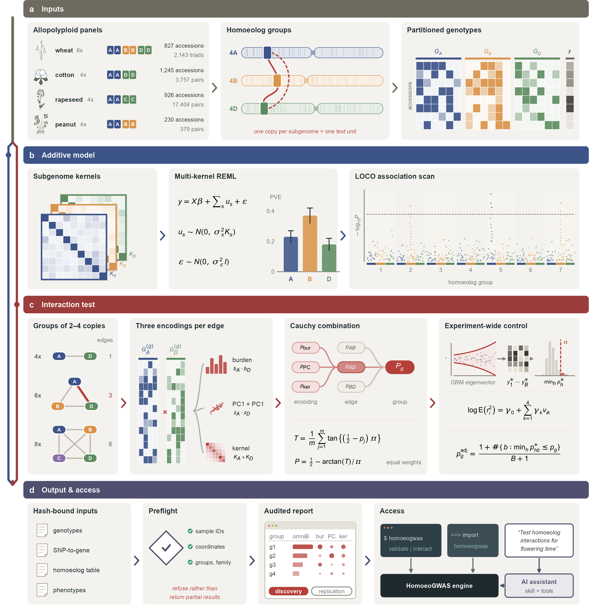

# HomoeoGWAS

<pre>
    __  __                                 _______       _____   _____
   / / / /___  ____ ___  ____  ___  ____  / ____/ |     / /   | / ___/
  / /_/ / __ \/ __ `__ \/ __ \/ _ \/ __ \/ / __ | | /| / / /| | \__ \ 
 / __  / /_/ / / / / / / /_/ /  __/ /_/ / /_/ / | |/ |/ / ___ |___/ / 
/_/ /_/\____/_/ /_/ /_/\____/\___/\____/\____/  |__/|__/_/  |_/____/  
</pre>

Subgenome-aware trait architecture and homoeolog-interaction analysis for
**allopolyploid crops**. Current release: **v2.2.0** (2026-11-06; `pip install homoeogwas`).

1. **Subgenome-stratified mixed model** — `y = Xβ + u_A + u_B [+ u_D ...] + ε`,
   one kinship matrix per subgenome, a multi-kernel REML variance partition
   (per-subgenome PVE) and a leave-one-chromosome-out per-SNP scan.
2. **Homoeolog interaction** — pair-edge omniB (minor burden, PC1,
   kernel-Hadamard) for groups of 2, 3 or 4 homoeologous copies, calibrated as
   one experiment-wide bootstrap-minP family with a kinship-preserving null
   (`smooth_pc4` residual variance by default for agent-run analyses).
3. **Evidence audit** — every finished run is labelled as computationally
   valid, an internal discovery, or in need of replication.

The global homoeolog Hadamard kernel and phenotype-independent priors remain
optional research extensions.

→ **[Getting Started](getting_started.md)** for install + first run
→ **[Algorithm](algorithm.md)** for the model
→ **[API Reference](api.md)** for module-level docs

## Citing and reproducing

Please cite the release you used (Zenodo concept DOI
[10.5281/zenodo.20668367](https://doi.org/10.5281/zenodo.20668367); see `CITATION.cff` in the repository).
The scripts, configurations, preregistrations and source data behind the figures and tables of the preprint
are in [HomoeoGWAS-reproducibility](https://github.com/Shipeng-Yang/HomoeoGWAS-reproducibility).
